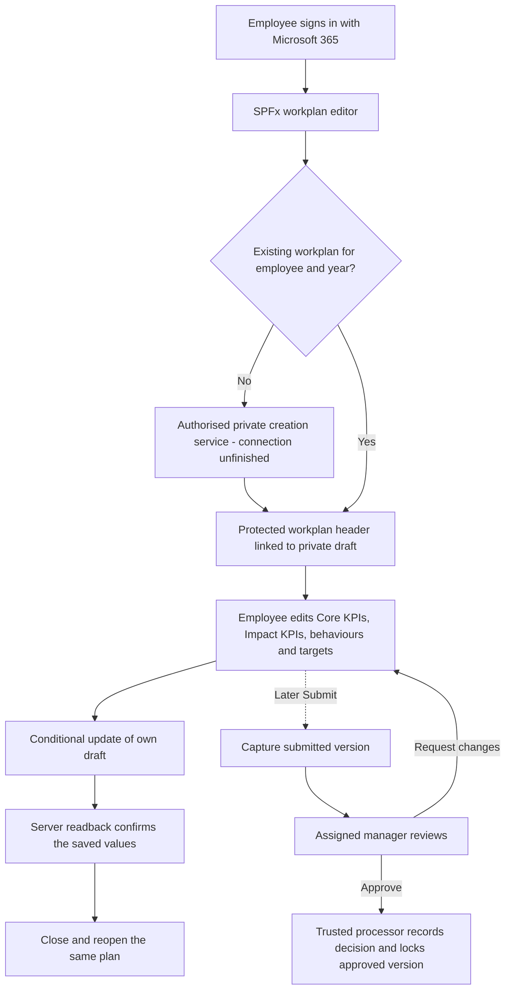
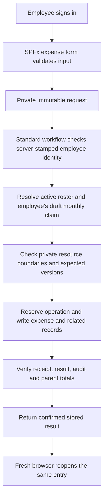
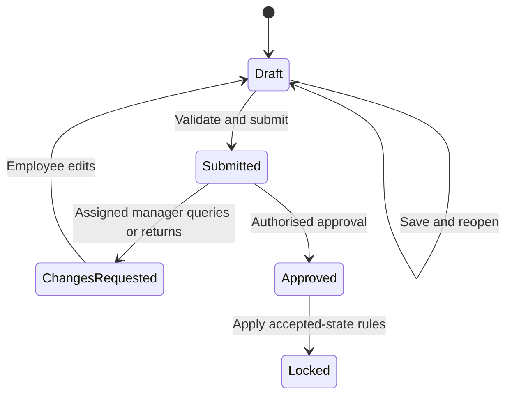

## Latest read-only evidence correction

The latest internal KPI summary inspected is **23 October 2026, 23:40 BST**. A prepared private workplan/draft pair and ordinary-user reads now exist; later source wiring has been reviewed but remains release-held and uncommitted. Native employee Save, cold reopen after Save, second Save, unrelated-user raw denial and receipt proof are still not established. A prepared time window is not an active test. Read [KPI-to-Expenses reuse](KPI_TO_EXPENSES_REUSE.md) before treating KPI as a working pattern to copy.

The broader supplied KPI snapshot predates those changes. The separately retained `kpi/save-path/` slice contains the later committed request-format repair, not the new private binding. These are source-inspection snapshots, not merged releases.
# Architecture, data and workflows to review

These diagrams describe intended/source-level behaviour. A solid arrow does not mean that the connection is currently installed or accepted. The supplied snapshots deliberately retain disabled or missing bindings. See [current issues](CURRENT_BLOCKERS.md).

## Platforms and code

Both apps use SharePoint Framework, React and TypeScript inside Microsoft 365. `package.json`, lockfiles, configuration and source are included separately for each project. Expenses also contains CommonJS workflow generators and source tests for Standard Power Automate operations. KPI includes processor/host definitions and tooling under `power-platform/`.

The AI coding agents help produce the software. They are not intended to approve employees' requests or sit inside the production Save transaction.

## KPI: first creation, Save and later approval

The header protects ownership, year, status and the link to the draft. The editable draft carries the employee's planning content. The browser must not be allowed to change protected ownership or approve itself. Version checks must prevent stale sessions from silently overwriting newer work; ambiguous network responses require reconciliation.

The source [physical schema](kpi/src/webparts/performanceHub/services/OptionEWorkplanPhysicalSchema.ts), [list bindings](kpi/src/webparts/performanceHub/services/OptionEWorkplanListBindings.ts) and [list-schema document](kpi/docs/PRODUCTION_LIST_SCHEMA.md) are the places to inspect actual field names. People/configuration/catalogue lists supply reference and role data. Later submission snapshots, decisions and audit records are separate concerns. A source declaration is not proof that a corresponding list/field exists in Microsoft 365.

## Expenses: request, trusted write and stored result

The code tries to handle duplicated requests and interruption across several stores. Review whether each native permission/read check is necessary at every stage, and whether a simpler maintained trust boundary can meet the same privacy and recovery requirements. Do not remove server-side protection simply to make a demonstration pass.

### Expenses resources

| Resource key | Intended purpose |
|---|---|
| requests | Private request document library, potentially including expense/receipt content |
| operations | Operation identity, duplicate prevention and recovery state |
| results | Private stored outcome returned to the employee |
| audit | Controlled actor/event/record history |
| expenses | Persisted expense lines and receipt references |
| claims | Employee/month parent, status, totals and reservation |
| people | Active roster and authenticated-user association |
| months | Period and availability rules |
| nominals | Eligible account-code references; only fictional master examples are public |

`expenses.ClaimSubmissionRef` links to claims. Claims link to people and months. The [source schema](expenses/app/kcf-expenses-hub/flow/private-fixture.cjs) defines field types; [the field map](review/EXPENSES_DATA_CONTRACT.csv) is a readable base-schema view. Later actor code adds a protected private-scope registry that must be reconciled separately. The base field map alone does not establish the complete live schema.

## Approval is not ordinary Draft Save

For Expenses, line-level queries retain other line decisions while unresolved items prevent final completion/export. Finance corrections and payroll export are later controlled actions. For KPI, the manager should review the captured submitted version rather than an unsubmitted private draft. Exact rights and transitions must be reconciled to each project's source; the diagram is a common review model, not a claim both share one implementation.

## Privacy proof required

Use two ordinary accounts. Prove the owner can perform the permitted operation and an unrelated user cannot read or change the plan/claim, request, result, audit payload or receipt through either the app or a direct storage address. An administrator's successful request and hidden UI controls are not that proof.
